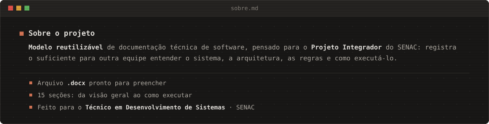
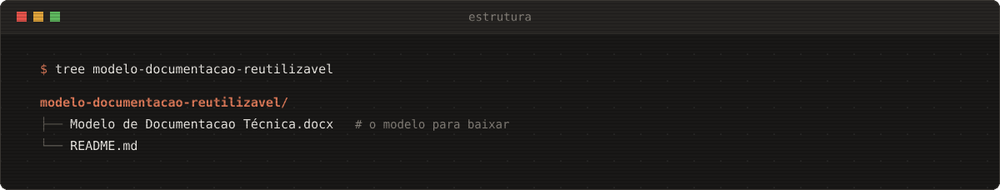

📥 **Arquivo:** [`Modelo de Documentacao Técnica.docx`](Modelo%20de%20Documentacao%20T%C3%A9cnica.docx)

1. Baixe o `.docx` e preencha os campos marcados com `[Preencher]`.
2. Atualize o histórico de alterações a cada nova versão.
3. Mantenha a documentação junto do código, de preferência em Markdown numa pasta `/docs`, com um README na raiz (Docs-as-Code).

Seções marcadas como *se necessário* (banco de dados, APIs, autenticação, testes) podem ficar de fora quando não existirem no projeto.

1. Visão geral do projeto
2. Escopo do sistema
3. Tecnologias utilizadas
4. Arquitetura da solução
5. Estrutura do projeto
6. Modelo de classes
7. Componentes e módulos
8. Funções e métodos relevantes
9. Banco de dados
10. APIs e integrações
11. Regras de negócio implementadas
12. Autenticação e segurança
13. Tratamento de erros
14. Testes
15. Como executar o projeto
16. Limitações e débitos técnicos
17. Próximas evoluções
18. Glossário técnico

Ele também traz capa, histórico de alterações e orientações de preenchimento em cada seção.

